# API Workshop 2026

Follow-along tutorial for ACM's API workshop. This builds on the React and Firebase workshops: you'll learn how to call APIs with **Postman**, then use Postman to call **your own** Flask backend, and finally add your own API endpoints to it.

> Missed the Firebase workshop? No problem. Everything works without Firebase except the two `/firebase` requests in Part 2.

---

## Things you'll need

- **Python**, which you can [download here](https://www.python.org/downloads/)
- **Node.js** (only if you want to run the React frontend), which you can [download here](https://nodejs.org/)
- **Postman desktop app**, which you can [download here](https://www.postman.com/downloads/). Sign in with Google is ok
  - Use the desktop app, not the website! The website version can't reach servers running on your own laptop (`127.0.0.1`)
- [Slide deck](SLIDES_LINK_HERE) for additional information

---

## Setup

1. Download this branch (`api-postman`) as a zip by clicking the green `Code` button and selecting `Download ZIP`
   1. If you're comfortable with GitHub, clone the repo and switch to this branch: `git checkout api-postman`
   2. git clone -b api-postman https://github.com/SCUACM/React-Workshop-2026.git |
      cd React-Workshop-2026 |
      git checkout api-postman
2. Unzip it and open the folder in VSCode. You should see the `backend` and `ReactWorkshop` folders
3. Open the terminal in VSCode (`Ctrl + ~`) and go into the backend folder: `cd backend`
4. If you don't have VSCode , thats fine! just type in this command in your terminal: cd Downloads/React-Workshop-2026-api-postman/backend
5. It is better to download VS code though, most CS kids have this anyways! Download here: https://code.visualstudio.com
6. Create a Python virtual environment, which keeps the packages you install local to this folder
   1. Mac/Linux: `python3 -m venv venv`
   2. Windows: `py -m venv venv`
7. Activate it
   1. Mac/Linux: `source venv/bin/activate`
   2. Windows: `.\venv\Scripts\activate`
   3. You should see `(venv)` at the start of your terminal from here on out. Whenever you run anything, make sure it's there
8. Install the packages listed in `requirements.txt` (pip is the Python package manager)
   - `pip install -r requirements.txt`
9. **(Optional) Firebase:** if you did the Firebase workshop, copy your `credentials.json` into the `backend` folder. Never commit this file! It's already in `backend/.gitignore`
10. If you want to still do the Firebase activity , you can follow these steps :
11. Create their own Firebase project with their personal Gmail.
12. Go to Project settings → Service accounts → Generate new private key. A .json file downloads.
Rename it to credentials.json and put it in your folder.

---

## Part 1: Accessing ACM's API with Postman

We'll be pinging the endpoints implemented in [this GitHub repo](https://github.com/SCUACM/token-api/blob/main/index.js).

1. Prove that you can access the API by typing `https://api.scuacm.com/` in a web browser

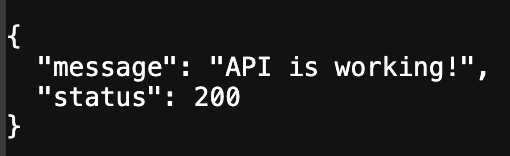

2. We want to access `https://api.scuacm.com/v1/data` to get our data, but that needs a token, which we can't send from a web browser's address bar

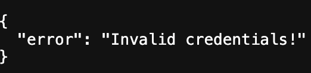

3. Download the collection file in this repo, `API_Workshop_2026.postman_collection.json`. Open Postman and click **Import**, then select that file
   - **Use the Import button.** Don't open the repo folder in Postman's folder view (Local Mode). If you do, Postman shows an "Upgrade files" warning and converts the JSON file into YAML files, deleting the original

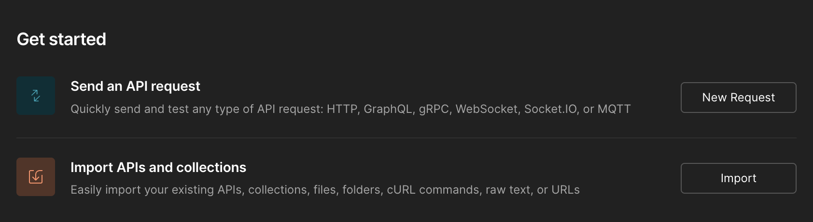

4. Open the **Part 1 - ACM API** folder. Run the **Confirm API** request and check that the response at the bottom is the same as in the web browser

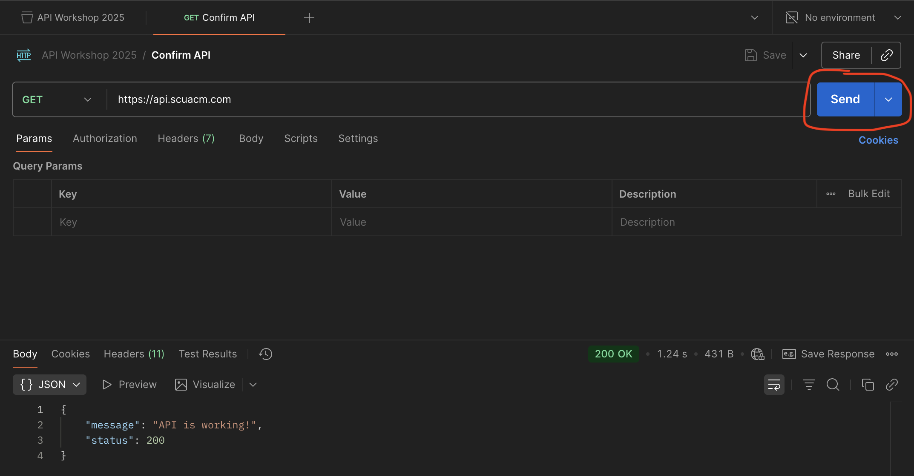

5. We need a token before we can get our data, but running **Get Token** (`/v1/token`) right away won't work. Click the **API Workshop 2026** collection, open the **Variables** tab, and set the `key` value to `acmKey123`
   1. In a real API, you'd get your key when you sign up on the provider's website. Keep it secret! Leaked keys can cost real money

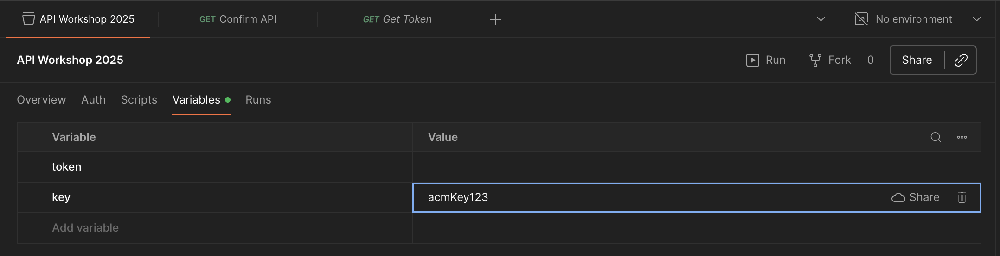

6. Run **Get Token**. The collection automatically puts the `key` variable into the URL as a **query parameter** (`?key=acmKey123`)

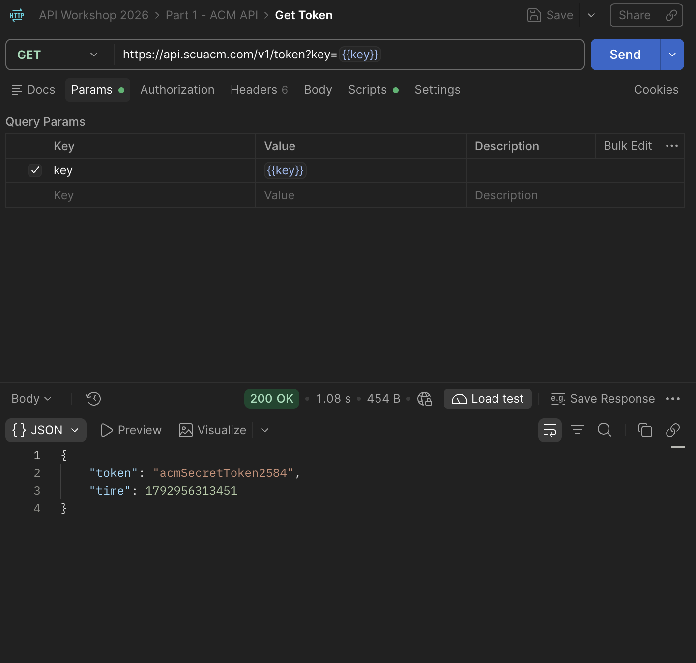

7. The Get Token request has a **Post-response script** that saves the token from the response into the `token` variable. Note the `pm.response.json()` and `data.token` snippets. You'll use the same idea to read API responses in your own code

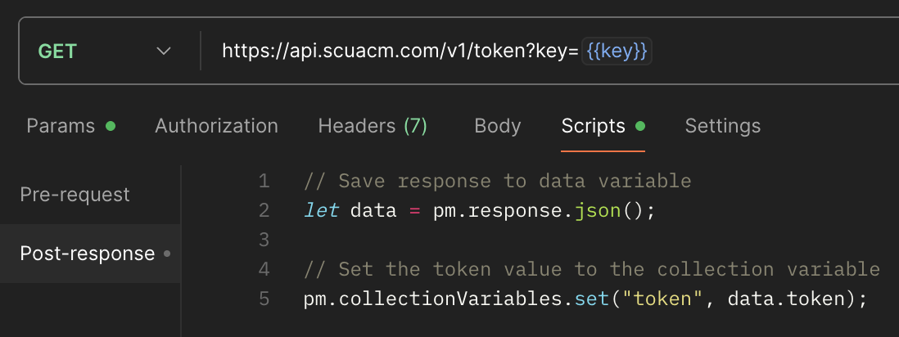

8. Now run **Get Data** to finally get our "sensitive" data. The token is sent as a **Bearer token** in the `Authorization` header, which is the standard way to prove who you are to an API

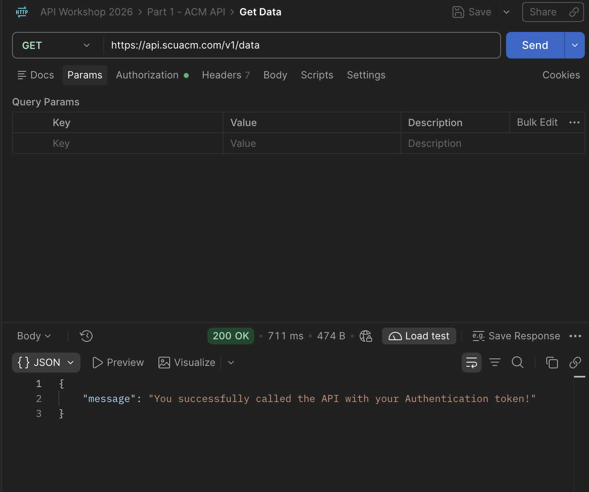

---

## Part 2: Calling YOUR backend with Postman

Postman isn't just for other people's APIs. It's how developers test their own. Let's point it at the Flask backend in this repo.

1. Start the server from the `backend` folder (with `(venv)` showing):
   - `python app.py`
   - You'll see `Running on http://127.0.0.1:8080`. Leave this terminal running! `Ctrl + C` stops it

<!-- SCREENSHOT TODO: terminal after `python app.py`, showing "Running on http://127.0.0.1:8080" -->
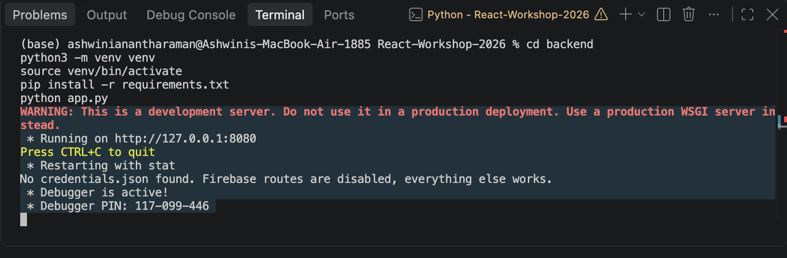

2. In Postman, open the **Part 2 - Our Backend** folder. Every request uses the `{{baseUrl}}` variable, which is set to `http://127.0.0.1:8080` (your own laptop)
3. Run **Hello**. Your own API just answered you!

<!-- SCREENSHOT TODO: Postman "Hello" request with 200 OK and {"message": "Hello, World!"} -->
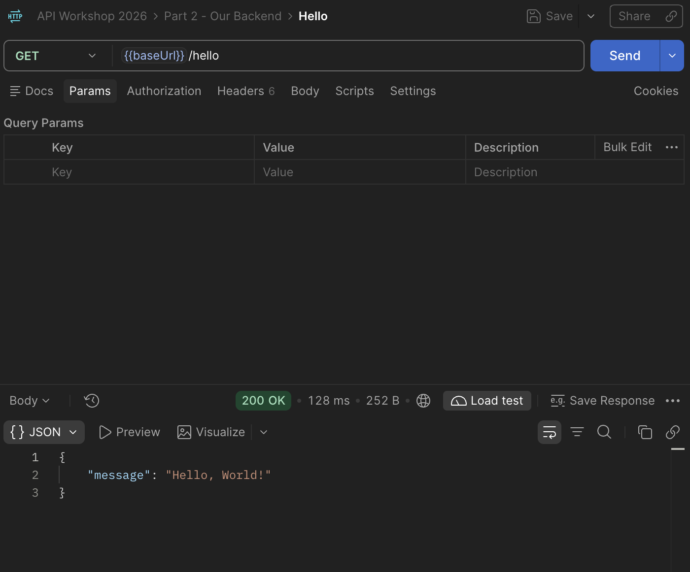

4. **(Firebase people)** Run **Firebase Get** to read the click counter you saved last workshop

<!-- SCREENSHOT TODO: Postman "Firebase Get" with the current_value / history response -->
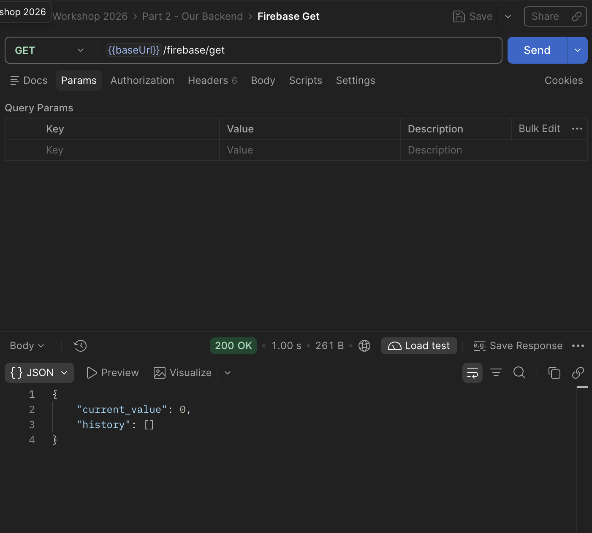

5. **(Firebase people)** Open **Firebase Set**, click the **Body** tab, and look at the JSON. This is a **POST** request: instead of asking for data, we're sending data to be saved. Change `current_value` to any number and click **Send**

```json
{
  "current_value": 42,
  "history": [1, 2, 42]
}
```

<!-- SCREENSHOT TODO: Postman "Firebase Set" with Body tab open (raw, JSON) and the "Data updated successfully" response -->
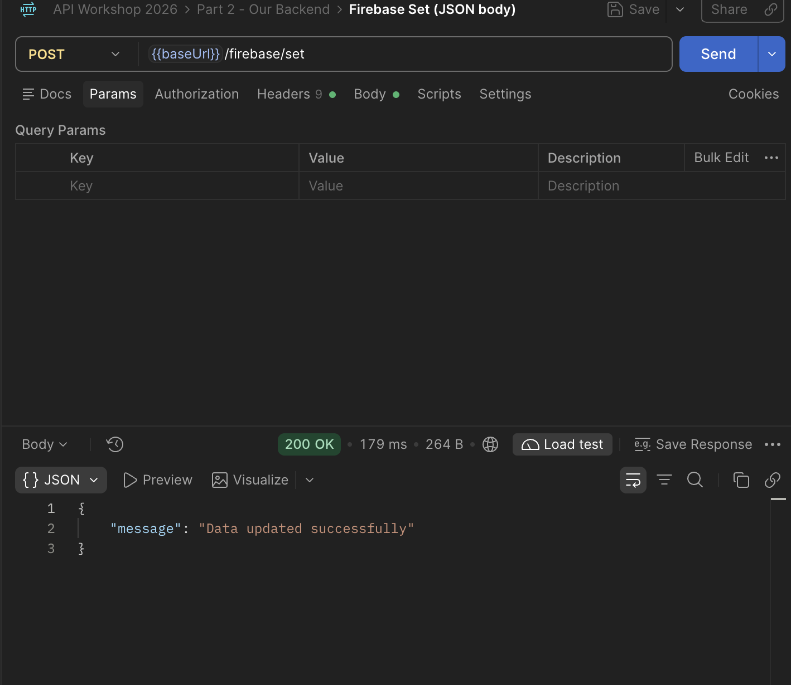

6. **(Firebase people)** Open your Firebase console and check the `clicker/counter` document. It changed, and you never touched the React app

<!-- SCREENSHOT TODO: Firebase console showing clicker > counter with current_value = 42 -->
7. (Optional) Firebase: only if you did the Firebase workshop. Skip this step otherwise. Everything except the two Firebase requests in Part 2 still works.
   1. Find your `credentials.json` file from last week. It's in last week's project folder, inside `backend`
      - **Can't find it?** Go to the [Firebase console](https://console.firebase.google.com), open your project, then ⚙️ **Project settings** → **Service accounts** → **Generate new private key**. Rename the downloaded file to exactly `credentials.json`
   2. Drag `credentials.json` onto the `backend` folder in VSCode's sidebar. It should sit right next to `app.py`
   3. Double-check the name is exactly `credentials.json` (not `credentials.json.json`)
   4. When you run `python app.py` later, you'll see `Firebase connected!`. If you see `No credentials.json found` instead, check steps 2–3 and restart the server (`Ctrl + C`, then `python app.py`)
   - ⚠️ This file is a secret key. Never commit it or share it! It's already listed in `backend/.gitignore`, so git will ignore it

---

## Part 3: Making our own API

Open `backend/app.py`. Below the Firebase routes are some new endpoints. Let's break them down.

### The basics

```py
@app.route("/hello")
def hello():
    return jsonify(message="Hello, World!")
```

- `@app.route("/hello")` means: when someone visits `/hello`, run this function
- `jsonify` turns Python values into a JSON response

### Passing data way #1: the URL (query parameters)

```py
@app.route("/add")
def add():
    a = request.args.get("a")
    b = request.args.get("b")
    if a is None or b is None:
        return jsonify(error="Missing 'a' and/or 'b' URL parameters"), 400
    try:
        return jsonify(result=int(a) + int(b))
    except ValueError:
        return jsonify(error="'a' and 'b' must be whole numbers"), 400
```

- Visit `http://127.0.0.1:8080/add?a=2&b=3` in your browser or run **Add (query params)** in Postman. You should get `{"result": 5}`
- Query parameters always arrive as **strings**, so we convert them with `int()`
- If something is missing or wrong, we return status code **400 (Bad Request)** instead of crashing
- Try it: change `a` to `hello` in Postman's **Params** tab and see the error

<!-- SCREENSHOT TODO: Postman "Add (query params)" showing the Params tab (a=2, b=3) and {"result": 5} -->
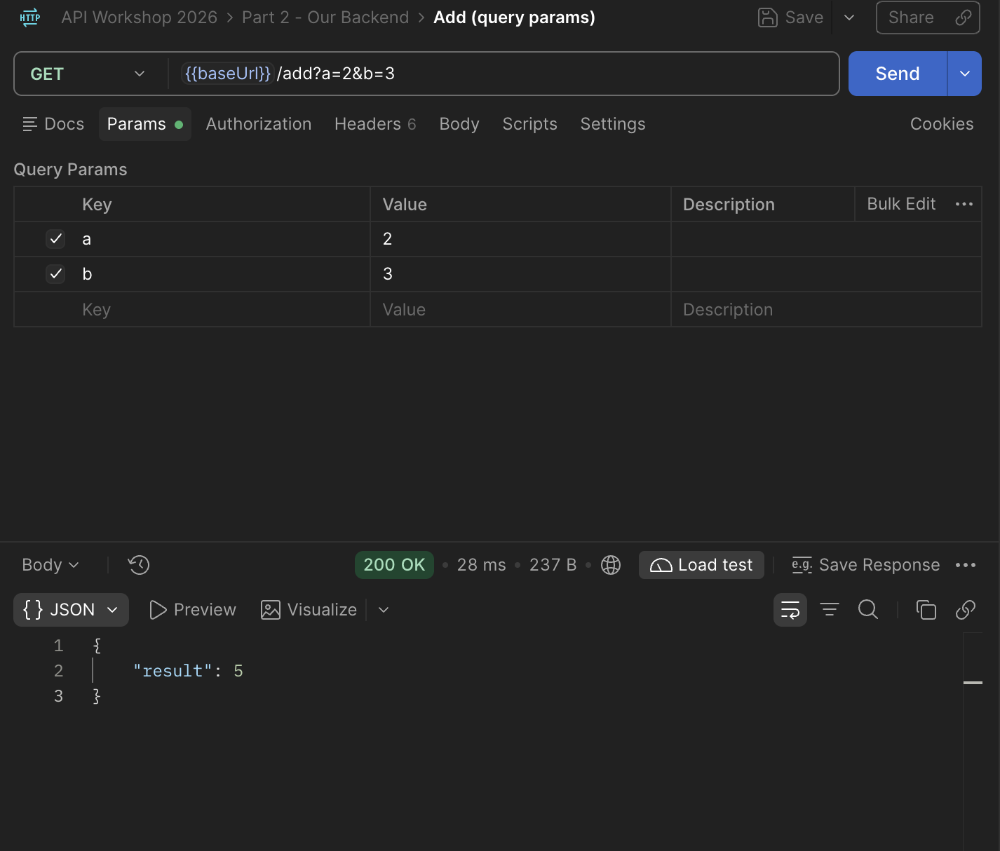

### A proxy API: calling another API from Python

```py
@app.route("/acm-token")
def acm_token():
    URL = "https://api.scuacm.com/v1/token"
    key = "acmKey123"
    data = requests.get(URL, params={"key": key}).json()  # expands to .../v1/token?key=acmKey123
    return jsonify(data=data, token=data.get("token"))
```

- This is exactly what Postman did in Part 1, but in Python with the `requests` library
- Your React app can call **your** backend, and your backend calls the real API. This is a **proxy API**, and it solves two problems:
  1. **Security:** the key lives on your server, not in your website's code where anyone can see it with Inspect Element
  2. **CORS:** browsers may block your website from calling some APIs directly, but servers aren't affected
- Run **ACM Token (through our proxy)** in Postman to try it

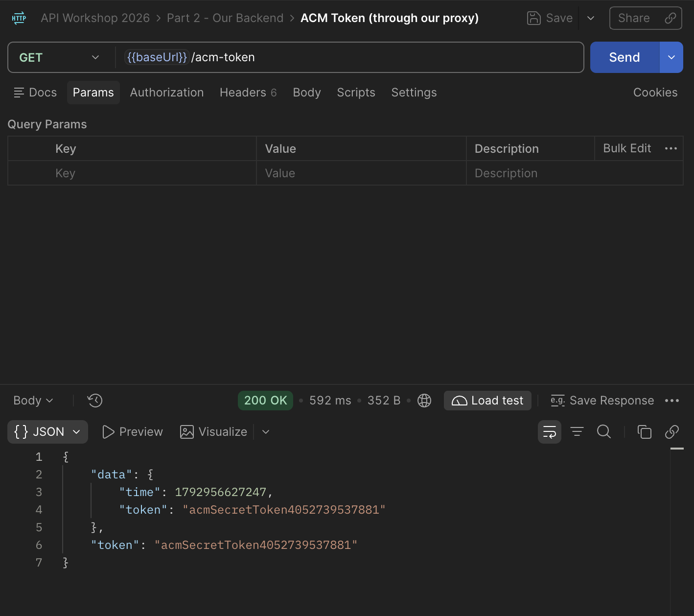

### Passing data way #2: the JSON body

```py
@app.route("/acm-data", methods=["POST"])
def acm_data():
    URL = "https://api.scuacm.com/v1/data"
    body = request.get_json(silent=True)
    if not body:
        return jsonify(error="Missing JSON body"), 400
    token = body.get("token")
    if not token:
        return jsonify(error="Missing 'token' in body"), 400
    headers = {"Authorization": f"Bearer {token}"}
    response = requests.get(URL, headers=headers)
    data = response.json()
    if response.status_code != 200:
        return jsonify(error=data.get("error", "Request failed")), response.status_code
    return jsonify(data=data.get("message"))
```

- `methods=["POST"]` means this endpoint expects data to be **sent** to it
- `request.get_json()` reads the JSON body
- The token is forwarded to ACM's API in the `Authorization` header using the **Bearer** method, just like Postman did in Part 1

---

## Challenge

The `/acm-data` endpoint needs a JSON body, which you can't send from a browser's address bar. Your task:

1. Create a new request in Postman and set it to **POST**
2. Set the URL to `{{baseUrl}}/acm-data`
3. Go to **Body**, choose **raw**, and set the type to **JSON**
4. Fill in the body with the format the endpoint needs and a valid ACM token
5. You should see the success message!

<details>
<summary>Stuck? Click for a hint</summary>

Run **Get Token** from Part 1 first. Then your body can use the saved variable:

```json
{
  "token": "{{token}}"
}
```

</details>

**Bonus:** write your own endpoint! Ideas: `/multiply`, a `/greet?name=...` that says hi to you, or a POST endpoint that saves something new to Firebase.

---

## Recap

- An **API** is a function you can run across the internet. It takes inputs and returns JSON plus a **status code** (200 OK, 400 Bad Request, 404 Not Found...)
- **GET** asks for data. **POST** sends data
- You can pass data in the **URL (query params)** or in the **JSON body**
- **Tokens** prove who you are and usually go in the `Authorization: Bearer ...` header
- **Postman** lets you test any API, including your own
- A **proxy API** keeps your keys secret and avoids CORS problems

Happy coding!
ACM
